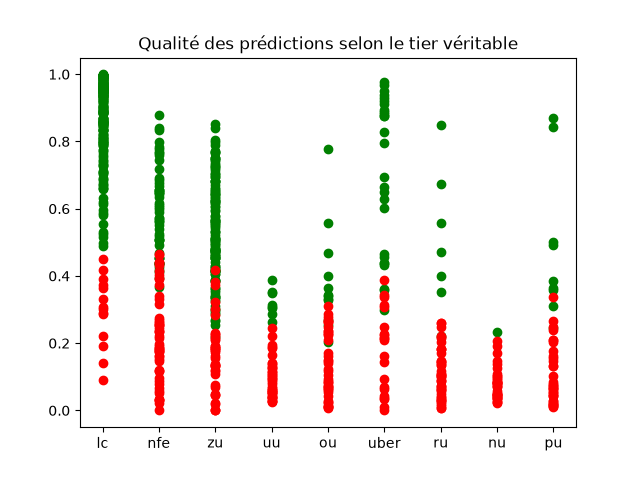

# Projet 2: de la donnée à l'application
*INF1007 gr. 04*\
*Nathan Vallée-Wilson (2544693) et Rémi Coulombe (2545018)*

Notre projet consiste à un modèle qui prédit a quel point un pokémon fictif serait bon en pokémon compétitif. Un des formats les plus populaires de pokémon compétitif s'agit des "singles", les combats 1 contre 1. Ce format est pratiqué en grande partie sur le site https://pokemonshowdown.com/ et est régi par https://www.smogon.com/. Le format est divisé en "tiers", des paliers définis par l'usage d'un pokémon qui limitent ceux qu'on peut utiliser. Ces tiers sont [1]:

- Anything Goes
- Uber
- OU : OverUsed
- UU (et UUBL) : UnderUsed
- RU (et RUBL) : RarelyUsed
- NU (et NUBL) : NeverUsed
- PU (et PUBL) : PoorlyUsed
- ZU (et ZUBL) : ZeroUsed
- NFE : Not Fully Evolved
- LC : Little Cup

Certains des formats ont une "banlist". Par exemple UUBL est l'ensemble des pokémons trop bons pour UU, donc qui y sont bannis, mais qui ne sont pas assez bons pour OU [2].

Notre projet vise a prédire dans quel tier un pokémon se retrouverait grace a un modèle de [STRATÉGIE UTILISÉE] entrainé sur un dataset comprennant tous le pokémons legaux dans les formats singles pour les jeux Pokémon Scarlet et Violet. 

## Jeu de données
Nos variables sont:

- Le numéro de pokédex. (quantitative)
- Le premier type du pokémon. (qualitative)
- Le deuxième type du pokémon, `aucun` s'il est monotype (qualitative)
- HP, les PV du pokémon. (quantitative)
- ATK, la stat d'attaque physique du pokémon. (quantitative)
- DEF, la stat de défense physique du pokémon. (quantitative)
- SPA, la stat d'attaque spéciale du pokémon. (quantitative)
- SPD, la stat de défense spéciale du pokémon. (quantitative)
- SPE, la stat de vitesse du pokémon. (quantitative)
- Coverage, le nombre de types uniques parmis les attaques du pokémon (quantitative)
- Power, la puissance la plus élevée parmis les attaques du pokémon (quantitative)
- Status, le nombre d'attaque de statut (qui ne font pas de dégâts et ont plutot un effet spécial) du pokémon (quantitative)

Nos données contiennent aussi les noms de chaque pokémon, chose qui n'est pas utilisé dans le modèle. Nous l'avons ajouté pour rendre les données plus lisibles.

Nous avons conçu notre jeu de données à partir de l'API "PokéAPI" et de Smogon [3][4]. Nos données de tiers de Smogon sont en date du retiering de octobre 2026 [5]. PokéAPI a la license BSD 3-Clause, qui permet l'usage en autant que la license est ajoutée au projet [6]. Les statistiques d'usage de Smogon n'ont pas de license explicite, mais sont disponible publiquement et utilisées de manière transformative régulièrement par la communauté.

Nous avons décidé de consolider certains tiers pour augmenter la taille d'échantillon associée à chaque tier. Les consolidations sont comme suit:

- Anything Goes → Uber
- UUBL → OU
- RUBL → UU
- NUBL → RU
- PUBL → NU
- ZUBL → PU

Anything Goes ne contient que 2 pokémons, qui sont bannis en Uber, donc c'est un tier peu pertinent à prédire. Pour les banlist, nous les avons ajouté au tier le plus bas sur l'échelle dans lequel ils sont légaux, afin d'augmenter la taille d'échantillon des tiers.

### Génération du dataset
Afin de générer le dataset localement, le fichier "get_api_dump.py" doit être éxécuté à complétion. Dû à la nature Web de la chose, cela pourrait prendre quelques essais. Une fois que cela est fait, le fichier dataset_builder est éxécuté et génère les fichiers du dataset, utilisé dans le reste de l'application.

## Outils utilisés
Notre choix de technologie pour l'interface graphique est Gradio [7]. 

## Pages consultées

- La documentation de Gradio [7]
- La documentation de scikit-learn [8]
- La documentation de pandas [9]

## Outil de fonctions complexes

Concept            | Application 
-------------------|------
Classes abstraites | Une classe abstraite "Model" est créée, afin de laisser les deux modèles partager la majorité de leur comportement. 
Lambda et map()    | Des mapping, soit par le constructeur inclut dans python ou la méthode DataFrame.apply() sont utilisés afin de modifier des données en profondeur dans une structure.
Requête web        | Pour l'obtention de fiches de Pokemon et de moves, des requêtes sont faites à PokeAPI [3]
Méthode magique    | Une méthode \_\_len\_\_(self) définie sur une classe définie localement

## Couverture
La perte logarithmique (valeur basse = mieux) des deux versions du modèle, RandomForest et LogisticReg est de 1.2, une faible amélioration vis-à-vis celle de 2.0 pour un modèle trivial hypothétique attribuant à chaque tier une probabilité égale à celle de sa fréquence dans le dataset. Le modèle RandomForest, pour une qualité comparable, se retrouve occuper un fichier près de 500 fois plus volumineux que son pair égal en fonction.

Une piste pouvant nous éclairer sur la cause de cela est que les échecs du modèle RandomForest ne sont pas du tout distribués également parmis les tiers. En effet, la figure ci-dessous démontre cela.

On peut observer que le les seuls tiers pour lesquels des essais à succès sont fait avec un haut degré de certitude sont les LC et les UBERs, les deux divisions les plus extrêmes de Smogon représentées dans le dataset final. Pour le tiering Smogon, généralement les Pokemon aux extrèmes sont vite classés sans trop de discussion au contact de la nouvelle génération, alors que les autres tiers, de OU à ZU sont négociés par le succès et la prévalence compétitive, souvent sujette à des situations relationelles entre les Pokemon membres des tiers. Ce comportement complexe est hors de portée du modèle simple que nous avons eu les moyen d'élaborer, et c'est pourquoi les tiers médians sont plus difficiles à prédire. Enfin, deux tiers sortent du lot un peu sont NFE, qui est décidé par le niveau d'évolution, et ZU, qui est le tier dans lequels les pires Pokemon inadmissibles en LC se retrouvent, deux façons avec moins de variance de classer les Pokemon.

## Références

[1] Smogon. (2026) Formats. [En ligne]. Disponible: https://www.smogon.com/dex/sv/formats/ (consulté le 23 novembre 2026)\
[2] Smogon. (2026) UUBL. [En ligne]. Disponible: https://www.smogon.com/dex/sm/formats/uubl/ (consulté le 23 novembre 2026)\
[3] PokéAPI. (2026) PokéAPI. [En ligne]. Disponible: https://pokeapi.co/ (consulté le 23 novembre 2026)\
[4] Smogon. (2026) Pokemon. [En ligne]. Disponible: https://www.smogon.com/dex/sv/pokemon/ (consulté le 11 novembre 2026)\
[5] Marty. (2026) Usage-Based Tier Update for October 2026 (November @ #19). [En ligne]. Disponible: https://www.smogon.com/forums/threads/usage-based-tier-update-for-october-2026-november-19.3789169/ (consulté le 23 novembre 2026)\
[6] P. Hallet. (2023) LICENSE.md. [En ligne]. Disponible: https://github.com/PokeAPI/pokeapi/blob/master/LICENSE.md (consulté le 23 novembre 2026)\
[7] Gradio. (2026) API Reference. [En ligne]. Disponible: https://gradio.app/docs (consulté le 23 novembre 2026)\
[8] scikit learn. (2026) API Reference. [En ligne]. Disponible: https://scikit-learn.org/stable/api/index.html (consulté le 23 novembre 2026)
[9] pandas. (2026) pandas documentation. [En ligne]. Disponible: https://pandas.pydata.org/docs/ (consulté le 23 novembre 2026)